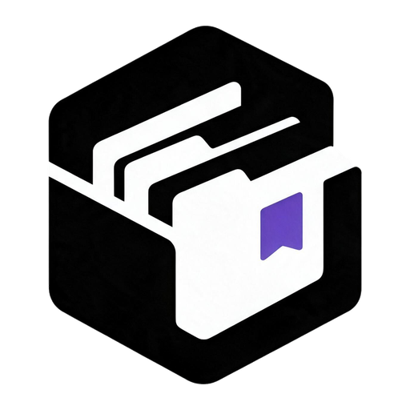

<p align="center">
  
</p>

# FolioChest / 资料匣

English | [简体中文](README.zh.md)

A locally run encrypted vault managed via a browser UI, with per-key AI access control over MCP.

`key`, `description`, and an optional single-level `group` are stored in plaintext so AI agents can discover relevant entries first, while `value` and attachments are encrypted with AES-256-GCM. External tools (such as Nutstore/Syncthing) handle file sync; FolioChest handles encryption, versioning, conflict detection, and per-key permissions.

> **Status:** Work in progress — see [SECURITY.md](SECURITY.md) for security status and known boundaries. Keep independent encrypted backups.

## Features

- **One Vault, One Master Password**: Bind one vault per local instance and organize it with groups. Locking stops both web and MCP data access. Maintenance supports location migration and same-vault recovery.
- **Local Web UI + Single Binary**: Go backend with an embedded React + TypeScript + shadcn/ui web app; no runtime Node.js or external CDN required.
- **Plaintext Discovery, Encrypted Payloads**: Argon2id (`64 MiB`, 3 iterations) key derivation + AES-256-GCM encryption for bodies and attachments.
- **Content & Organization**: Plaintext, Markdown (with safe preview, no HTML/remote image loading), JSON editing assistance, encrypted attachments, single-level groups, history browsing/restore, conflict merging, and soft-delete trash.
- **Per-Key MCP Permissions**: Independent `allow` / `ask` / `deny` policies for read and replace per key, with client bearer tokens, legacy session form elicitation, MCP `2026-07-28` multi-round-trip read approval, and fallback webpage approval.
- **Backup & Recovery**: Full encrypted ZIP backup export and validated restore into a new/empty directory.
- **Device Convenience & Locking**: Optional OS credential storage (Windows Credential Manager / Linux Secret Service), browser remember-me (90 days), user-level login autostart, idle auto-lock, and system lock/sleep event locking.

## Quick Start (From Source)

Requires **Go 1.26+** and **Node.js 24+**.

```bash
npm --prefix web ci
npm --prefix web run build
go run ./cmd/foliochest
```

Open `http://127.0.0.1:7463/` to create, attach, or restore your single vault on first use; subsequent visits use its master password. Location migration retains the original files and copies local empty groups.

Build a standalone binary:

```bash
make build
./bin/foliochest
```

For isolated development testing without touching your default config directory:

```bash
./bin/foliochest --device-dir "$PWD/.local/test-device"
```

### CLI Flags

- `--device-dir`: Local device state directory (excluded from vault sync; defaults to `<UserConfigDir>/keyfolio`)
- `--vault`: Vault directory path (can also be chosen in the web UI)
- `--listen`: Loopback listen address (default `127.0.0.1:7463`)
- `--background`: Start the background service without opening the browser

Closing the browser tab does not stop the background service; use the **Exit** button in the web UI.

## MCP Integration

1. Start and unlock FolioChest, then copy the default **stdio** configuration from **Settings → MCP**. It runs `foliochest mcp` with the executable path and device directory; no token is needed. Start the application first — the sidecar only forwards to it, and each connection has isolated approvals.
2. Only explicitly selecting **HTTP (advanced)** enables `/mcp` and token creation. Configure `Authorization: Bearer <token>`. Modes are exclusive; switching locks the vault and invalidates pending approvals.
3. Per-client approval mode: add `--approval web` to the stdio args (or send the `X-FolioChest-Approval: web` header on HTTP) to route approvals to the local webpage — pending requests immediately return an `approval_url`. This suits clients whose harness has no native MCP elicitation UI (e.g. Antigravity CLI). Only `auto` (default) and `web` are accepted.

| Tool | Purpose |
| --- | --- |
| `discover_entries` | Directory/search with `query`, exact `group` and `keys` filters; optional `include_description` (default true); `offset`/`limit` pagination (default 100, max 200), returns `total`/`next_offset`; never returns bodies |
| `list_groups` | Active group names and counts; optional `include_empty` includes local-only empty groups; excludes trash members |
| `read_entries` | Request plaintext `value` or attachments for specific keys under per-key read policy |
| `replace_entries` | Submit full replacements bound to `expected_revision` under per-key write policy |
| `request_result` | Poll or claim the result of a pending/approved request once |

Discovery is key-sorted, not a fixed snapshot: restart pagination when concurrent writes or sync change the directory. Exact `keys` are limited to 100; body read/write batches remain limited to 20.

HTTP example with `pi` (after enabling HTTP and exporting `FOLIOCHEST_TOKEN`):

```bash
pi mcp add foliochest --url http://127.0.0.1:7463/mcp --bearer-token-env-var FOLIOCHEST_TOKEN
```

## Updating an Installed Application

In **Settings → Vault**, check for updates, download and verify the matching installer, then confirm **Exit and update**. Save edits, export a backup and pause other-device writes first — the vault is locked and MCP disconnects before exit. Windows opens the setup wizard; Linux prefers GNOME Software / KDE Discover, falling back to the default file association (install the RPM/DEB manually if no installer is configured). Same-architecture upgrades need no uninstalling; vaults and device settings are retained. Afterwards, start the app again from the system menu and update all synced devices.

Packages are unsigned: SHA-256 verifies integrity, not publisher identity (see [SECURITY.md](SECURITY.md)). Verified packages and diagnostics are kept under the device directory’s `updates/` for manual retry.

## Packaging & Cross-Compilation

Build portable archives (`dist/`):

```bash
make package
```

Build portable archives plus Windows NSIS installers (`x64`, experimental `x86`) and Linux `DEB`/`RPM` (`amd64`, `arm64`) using **NSIS 3.11** and **nFPM 2.49.0**:

```bash
make installers
```

See [packaging/README.md](packaging/README.md) and [docs/RELEASING.md](docs/RELEASING.md) for toolchain and release details.

## Testing

```bash
make check
```

Runs frontend type-checking, frontend unit tests, `go vet ./...`, and `go test -race ./...` (requires `npm --prefix web run build` first when running Go tests directly because `web/embed.go` embeds `web/dist/`).

## Limits

- Body max: `1 MiB`; attachments: up to `16` per entry, `2 MiB` each.
- Write/read batch max: `20` entries, `8 MiB` serialized payload.
- Vault records max: `64 MiB` total, `4096` files (including retained history).
- Approval TTL: `5` minutes, single-claim result.
- Different-`entry_id` key name collisions are flagged as conflicts and not auto-merged.

## Documentation

- [Design Overview](docs/DESIGN.md)
- [Security & Consistency Boundaries](docs/BOUNDARIES.md)
- [Vault File Format](docs/FORMAT.md)
- [Security Policy](SECURITY.md)
- [Contributing](CONTRIBUTING.md)
- [Release Process](docs/RELEASING.md)

## License

[MIT License](LICENSE). Third-party components and notices are preserved in [web/src/components/ui/NOTICE.md](web/src/components/ui/NOTICE.md) and collected into release packages by `tools/package`.
