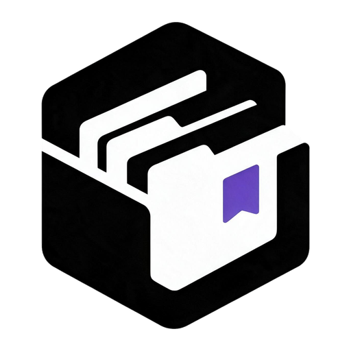

<p align="center">
  
</p>

# FolioChest / 资料匣

[English](README.md) | 简体中文

本地运行、通过网页管理、按 `key` 向 AI 授权的加密资料库。

`key`、`description` 和可选的单层 `group` 保持明文，供 AI 优先检索判断；`value` 与附件使用 AES-256-GCM 加密。外部同步工具（如坚果云等）负责同步文件，资料匣负责加解密、版本历史、冲突检测与按 key 权限控制。

> **当前阶段（`0.6.1-dev`）：** 可运行原型。Windows 真机运行/安装验收和独立安全审计尚未完成，请先使用合成数据并保留独立备份。

## 核心特性

- **一个资料库、一套主密码**：首次创建或接入一个库，日常用分组整理。锁定同时停止网页和 MCP 访问；设置中可迁移保存位置或恢复本库备份，不提供切换其他库。
- **本地网页与单文件分发**：Go 后端内嵌 React + TypeScript + shadcn/ui 前端，运行时无需 Node.js 或外部 CDN。
- **明文发现 + 加密正文**：Argon2id（`64 MiB`、3 次迭代）派生解锁密钥，AES-256-GCM 保护库密钥、正文与附件。
- **内容与组织**：支持纯文本、Markdown 安全预览（禁用 HTML 与外链图片）、JSON 辅助编辑、加密附件、单层分组、历史浏览/恢复、分支冲突合并与回收站。
- **按 Key 的 MCP 权限**：每个 key 独立配置读取与修改三态策略（无须授权 / 需要授权 / 拒绝），支持独立客户端凭据、旧版会话内 form elicitation、MCP `2026-07-28` 多轮读取审批及网页备用审批。
- **备份与恢复**：完整 ZIP 备份导出，导入前校验密码、认证标签与版本依赖，仅恢复到新目录或空目录。
- **设备集成与自动锁定**：可选系统凭据库自动解锁（Windows Credential Manager / Linux Secret Service）、90 天记住浏览器、用户级登录自启动、网页空闲锁定及系统锁屏/休眠锁定。

## 快速开始（源码运行）

需要 **Go 1.26+** 与 **Node.js 24+**。

```bash
npm --prefix web ci
npm --prefix web run build
go run ./cmd/foliochest
```

访问 `http://127.0.0.1:7463/`，首次创建、接入已有资料库或从备份恢复；之后使用同一个主密码解锁资料匣。迁移位置保留原文件并一并复制本机空组；独立空组暂不包含在 ZIP 备份中。

构建独立可执行文件：

```bash
make build
./bin/foliochest
```

开发测试时使用隔离的设备配置目录：

```bash
./bin/foliochest --device-dir "$PWD/.local/test-device"
```

### 常用启动参数

- `--device-dir`：本机设备配置目录（不参与同步，默认为系统用户配置目录下的 `keyfolio/`）
- `--vault`：资料库目录（也可在网页中选择）
- `--listen`：回环监听地址（默认 `127.0.0.1:7463`）
- `--background`：仅启动后台服务，不打开浏览器

关闭浏览器标签页不会退出后台，请通过网页中的“退出资料匣”按钮停止服务并锁定资料库。

## MCP 接入

1. 先启动资料匣并在网页解锁，打开 **设置 → MCP**，复制默认的 stdio 配置到 AI 客户端。命令为 `foliochest mcp`；设置页会生成当前程序的完整路径及 `--device-dir`，不需要手动配置 Token。
2. stdio 子进程只转接已经运行的本机后台，不独立打开或解锁资料库；后台未启动时明确报错，不自动打开浏览器。每个连接隔离审批，退出客户端不退出资料匣。
3. 只有明确选择 **HTTP（高级）** 并确认后，才开放 `http://127.0.0.1:7463/mcp`；此时创建客户端凭据并配置 `Authorization: Bearer <接入凭据>`。两种接入方式互斥，切换会锁库、使旧审批失效，需重新解锁和连接。升级后未保存接入方式的旧安装默认 stdio，旧 HTTP Token 保留但不启用。

| 工具 | 用途 |
| --- | --- |
| `discover_entries` | 目录／搜索：`query`、精确 `group` 与 `keys` 可组合；`include_description` 默认 true；`offset` / `limit` 分页，默认 100、最大 200，返回 `total` / `next_offset`；不返回正文 |
| `list_groups` | 返回非删除资料的分组名称及数量，`include_empty` 可包含本机空组（不参与同步）；不返回回收站成员 |
| `read_entries` | 按 key 策略申请读取正文或指定附件 |
| `replace_entries` | 基于 `expected_revision` 按修改策略提交完整替换 |
| `request_result` | 查询待审批状态，并单次领取已批准的执行结果 |

目录按 key 排序，分页不是固定快照；同步或写入期间目录变化时应重新遍历。`keys` 最多 100 个，正文读写批次仍最多 20 条。

选择 HTTP 后，以 `pi` 为例（先设置 `FOLIOCHEST_TOKEN` 环境变量）：

```bash
pi mcp add foliochest --url http://127.0.0.1:7463/mcp --bearer-token-env-var FOLIOCHEST_TOKEN
```

## 更新已安装程序

设置 → 资料库 → **检查更新**，按提示下载匹配系统的安装包并校验，再点击 **退出并更新**。Windows 打开覆盖安装向导；Linux 优先打开 GNOME Software / KDE Discover，必要时交给默认文件关联（没有软件安装器时需手动安装 RPM / DEB）。同架构正常升级无需先卸载，资料库与本机配置保留。

更新前保存编辑、导出备份并暂停其他设备写入。程序锁库、断开 MCP 后退出；完成安装后从系统应用菜单重新启动。双机请一起更新。当前包未签名，SHA-256 只检查完整性，不替代发布者签名。安装器未出现或失败时，可按页面提示手动安装已下载文件；设备目录 `updates/` 保留安装包与诊断日志。不后台检查、不静默提权或安装，也不承诺自动回滚。

## 打包与跨平台构建

生成免安装包（输出至 `dist/`）：

```bash
make package
```

生成免安装包及 Windows NSIS 安装器（x64、实验性 x86）、Linux DEB/RPM（amd64/arm64），需本机安装 **NSIS 3.11** 与 **nFPM 2.49.0**：

```bash
make installers
```

详细工具链与发布流程见 [packaging/README.md](packaging/README.md) 与 [docs/RELEASING.md](docs/RELEASING.md)。

## 测试

```bash
make check
```

依次执行前端类型检查、前端单元测试、`go vet ./...` 和 `go test -race ./...`（直接执行 Go 测试前需先 `npm --prefix web run build`，因为 `web/embed.go` 会嵌入 `web/dist/`）。

## 原型限制

- 单条正文上限 `1 MiB`；每条最多 `16` 个附件，单个附件上限 `2 MiB`。
- 单次批量读写上限 `20` 条、`8 MiB` 序列化载荷。
- 资料库记录总量上限 `64 MiB`、`4096` 个文件（含历史版本）。
- 审批请求有效期 `5` 分钟，结果仅可领取一次。
- 不同 `entry_id` 的同名冲突当前仅拦截并标记冲突，不自动合并。

## 文档

- [项目设计](docs/DESIGN.md)
- [边界与安全说明](docs/BOUNDARIES.md)
- [文件格式](docs/FORMAT.md)
- [安全策略](SECURITY.md)
- [贡献指南](CONTRIBUTING.md)
- [发布流程](docs/RELEASING.md)

## 许可证

采用 [MIT License](LICENSE)。第三方组件与许可证声明保留在 [web/src/components/ui/NOTICE.md](web/src/components/ui/NOTICE.md)，并在打包时由 `tools/package` 一并收集。
